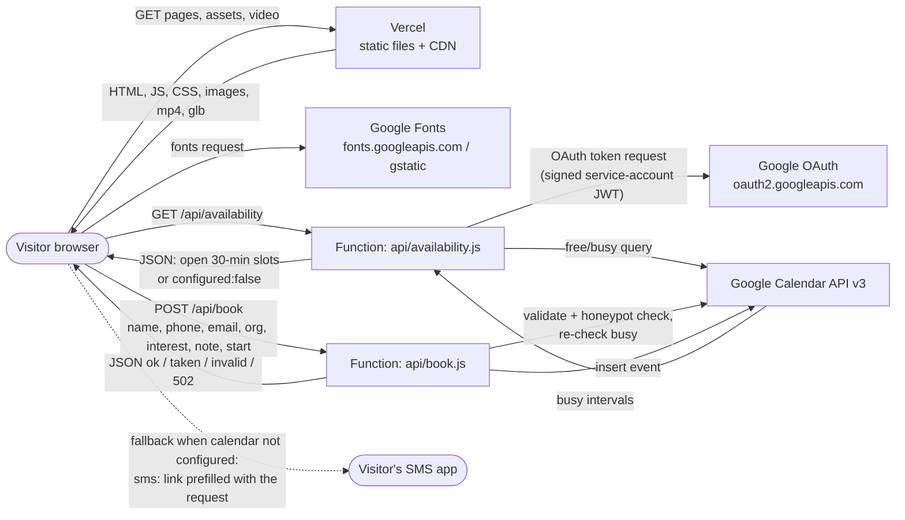
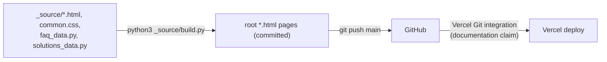
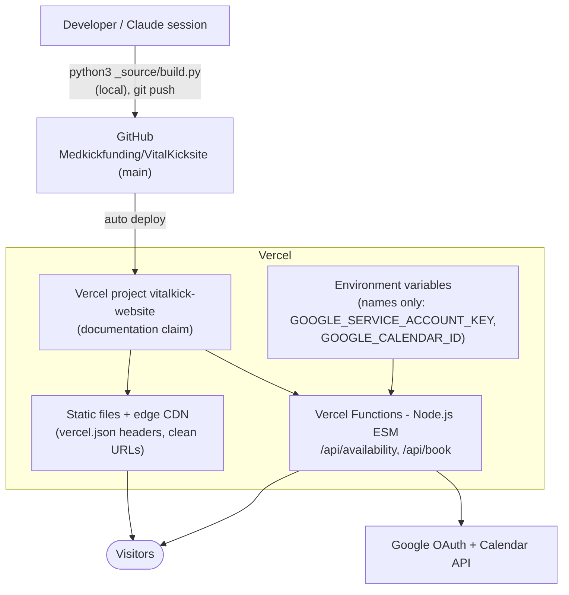

# VitalKick Website - Architecture Diagram

Generated per the app-architecture-diagram skill. Based only on what exists in this repository: `vercel.json`, `.vercelignore`, `package.json`, `api/*.js`, the HTML pages, `_source/build.py`, `_reel/`, `tools/`, `DEPLOY.md`, and `HANDOFF.md`. No secrets, environment values, or patient information are included (the site collects no health information; the booking form is limited to contact details).

Items that the repo cannot confirm are marked **Uncertain**. Statements taken from prose docs rather than config (for example the live domain) are marked as documentation claims.

## 1. Data Flows

The site is static HTML/CSS/JS served from Vercel, plus two Vercel serverless functions for the "Book a call" page.

Request and response paths:

- Static pages: GET only; no server-side rendering and no build step on Vercel (pages are pre-generated and committed).
- Booking: the browser calls the two functions with `fetch`. The function authenticates to Google as a service account and returns JSON. Nothing is written to a database owned by this project; the only persisted record of a booking is the Google Calendar event.
- Fallback: if the Google variables are not set, `book` returns `503 {configured:false}` and the page offers a text-message (`sms:`) link instead (per `DEPLOY.md`; also visible in `research.html` and `thanks.html`).

Build-time flow (offline, not on Vercel): `_source/build.py` combines `_source/*.body.html`, `common.css`, and data files and writes the HTML pages to the repo root; the generated pages are committed.

## 2. Infrastructure

- **Platform: Vercel.** Static hosting plus Vercel Functions. Evidence: `vercel.json` (clean URLs, cache and security headers), `api/` directory with default-export `(req, res)` handlers, and `DEPLOY.md`/`HANDOFF.md`.
- **Function runtime:** Serverless Node.js functions (ES modules; `package.json` has `"type": "module"` and `"engines": {"node": ">=20"}`). No `runtime`, `memory`, or `maxDuration` overrides are set, so Vercel defaults apply (**Uncertain** what those are on the account's plan).
- **Project and domain (documentation claim):** `HANDOFF.md` states the site is served by the Vercel project `vitalkick-website` at `vitalkick.sireenai.com` and `vitalkick-website.vercel.app`, auto-deploying the `main` branch. This cannot be verified from the repo.
- **Deploy trigger:** Vercel Git integration is described in the docs. There is no GitHub Actions workflow or other CI in this repo (no `.github/` directory).
- **Config notes:** `vercel.json` sets `cleanUrls`, `Cache-Control: public, max-age=604800` for `/assets/*`, and `X-Content-Type-Options`, `Referrer-Policy`, `Permissions-Policy` (camera, microphone, geolocation disabled) for all routes. `.vercelignore` excludes `_source`, `_reel`, `tools`, `.claude`, and several markdown docs from the deployment.
- **Superseded:** `HOW-TO-PUBLISH.md` describes GitHub Pages, and says it is superseded by Vercel. It is not the current host.
- **Not present:** Dockerfile, Railway config, AWS resources, database config, queues, cron.

## 3. Compute Resources

| Unit | Runtime | Size / memory | Trigger |
|---|---|---|---|
| `api/availability.js` | Vercel Function, Node.js (ES module) | Default (not configured in repo) | HTTP GET `/api/availability` |
| `api/book.js` | Vercel Function, Node.js (ES module) | Default (not configured in repo) | HTTP POST `/api/book` (other methods return 405) |
| `api/_google.js`, `api/_slots.js` | Shared modules imported by the two functions (files starting with `_` are not routes) | n/a | Imported at call time |
| Browser JavaScript (three.js bundle `assets/three.module.min.js`, `skin3d.js`, `biomarkers.js`, `icons.js`, inline page scripts) | Client-side JS | n/a | Page load and scroll |

Offline tooling, not deployed: `_source/build.py` (Python), `tools/check_copy.py` (Python copy check against `tools/banned-phrases.json`), `tools/shots/shoot.mjs` (Node/Playwright screenshots), and `_reel/` (Node scripts using playwright-core and three.js, plus `audio.py` and `sheet.py`, to render the reel video). These run manually on a developer machine.

Background workers, queues, cron jobs, containers, VMs: None identified.

## 4. Data Resources

| Store | Engine | Managed? | Holds |
|---|---|---|---|
| Git repository (GitHub) | Git | Managed (GitHub) | All site content: HTML, JS, images, `assets/vitalkick-reel.mp4`, 3D/animation data (`face-mesh.json`, `seq/*`) |
| Vercel static deployment / CDN | Vercel-managed file hosting | Managed | The served copy of the site files |
| Google Calendar (the owner's calendar) | Google Calendar | Managed (Google) | Booked call events: name, phone, email, organisation, interest, and an optional note (per `api/book.js`); this is the only place booking data persists |
| Vercel environment variables | Vercel-managed secrets store | Managed | Holds the Google credentials used by the functions (values not in repo) |

Databases, caches, object storage, file systems, vector stores: None identified. The function code keeps no state of its own (it re-checks the calendar on every booking to avoid double booking).

## 5. Upstream Data Sources

| Source | Provider | Purpose |
|---|---|---|
| Visitor input | Booking form on `book.html` (name, phone, email, organisation, topic, note, chosen time) | Booking requests sent to `/api/book` |
| Google Calendar API v3 | Google | Reads busy times for slot availability and re-checks them before booking |
| Google OAuth token endpoint | Google (`oauth2.googleapis.com`) | Exchanges a service-account signed JWT for an access token |
| Google Fonts | Google (`fonts.googleapis.com`, `fonts.gstatic.com`) | Inter, Instrument Serif, and JetBrains Mono, linked from every page |
| Environment configuration | Vercel env vars (names `GOOGLE_SERVICE_ACCOUNT_KEY`, `GOOGLE_CALENDAR_ID`) | Calendar credentials and target calendar; per `HANDOFF.md` these are not yet connected |

Webhooks received, message queues, other third-party APIs: None identified.

## 6. Downstream Consumers

| Consumer | What it takes from the site |
|---|---|
| Website visitors (browsers) | Static pages, assets, the reel video, and booking JSON responses |
| Google Calendar (owner's calendar) | Created events for booked calls (name, contact details, interest, note) via `api/book.js` |
| Visitor's SMS app | A prefilled `sms:` link built in the browser (fallback and confirmation actions on `research.html` and `thanks.html`) |
| Analytics, email or notification pipelines, data warehouse, other services | None identified (no analytics script or email-sending code in the repo) |

The marketing site does not call the VitalKick mobile app's Supabase backend, and no such dependency exists in this repo.

## Maintenance

Update this file in the same change whenever `vercel.json`, the `api/` functions, environment variable names, or external integrations change.
